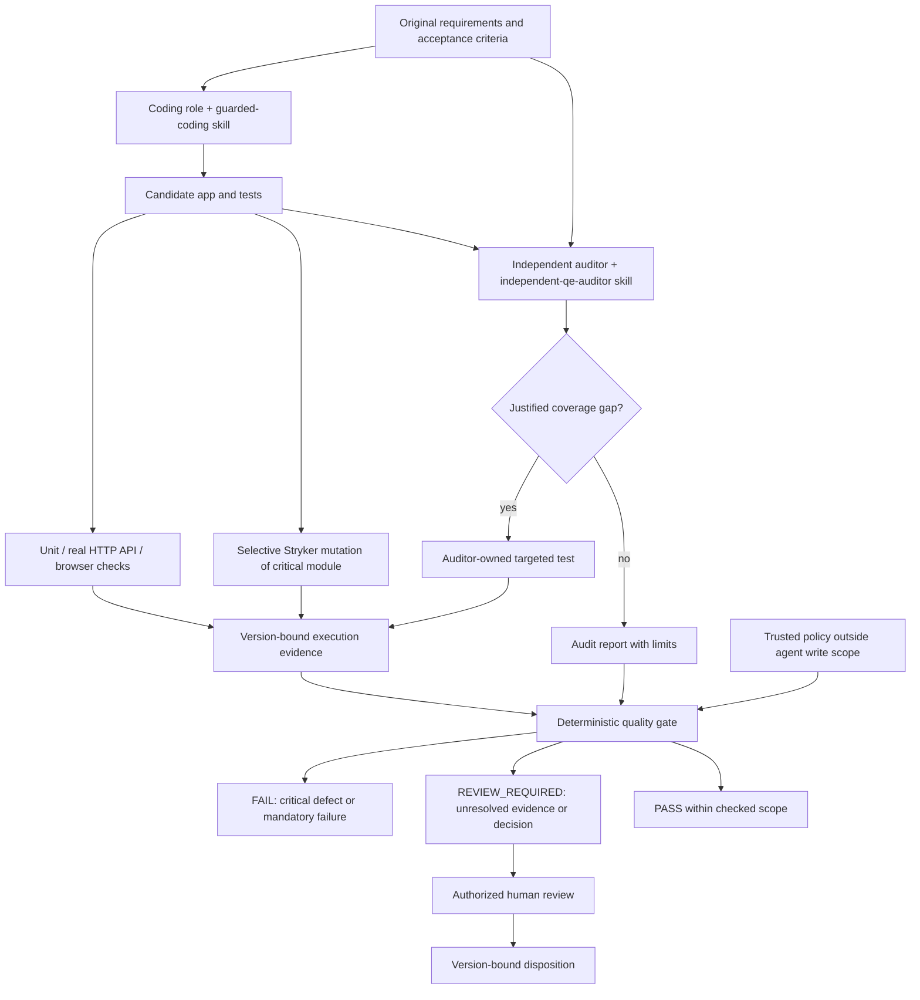

# Independent quality evidence architecture

This extension starts from Hyper-Agile Quality's separation of **checks**, **instructions**,
**hypotheses** and **human decisions**. The original Python investigation CLI remains separate
from the TypeScript healthcare demo. Reusing a methodology is not the same as calling its code:
consult the implementation and verification record for the exact executable integrations.

## The teaching example

The application uses only fictional patient records. The normal implementation must enforce
ownership on the server, using a server-recognized identity rather than a patient ID supplied
by the browser. The vulnerable implementation belongs only in benchmark fixtures.

The demonstration separates four events:

1. **Existing tests PASS:** the happy path runs but does not test another patient's resource.
   This says nothing about whether authorization is correct.
2. **Audit FAIL:** the missing risk condition justifies a targeted real HTTP test. The
   vulnerable fixture returns information it should deny, and the test fails.
3. **FIX:** the secure implementation enforces the ownership condition. The demo represents the fix with a separate secure implementation; it does not have an LLM
   edit the application during each run. The same assertion is retained, rather than a modified
   expectation or relaxed threshold.
4. **Regression PASS:** the discriminating test now passes and remains a permanent regression.

A real execution of this sequence verifies a seeded defect and its test. It does not by itself
prove an LLM independently discovered the gap. Label deterministic gap analysis and live-agent
trials separately, and do not report either as general healthcare-security assurance.

## Two test layers with different purposes

**Application verification** exercises code and behavior: unit assertions, real HTTP checks,
browser flows and selective mutation. Mutation asks whether tests detect specific code changes;
it cannot establish that all important requirements were identified.

**Agent evaluation** examines the workflow's behavior: requirement reasoning, justified test
selection, refusal to weaken tests, handling of missing evidence, and escalation. A deterministic
golden suite can test graders and policy. Measuring a model needs actual recorded model runs,
blind inputs and independently established expectations. Fixture scores and model scores must
never share an unlabeled denominator.

## Evidence integrity is not evidence truth

A source hash and matching test report can detect staleness or inconsistency. They cannot prove
that a malicious producer did not rewrite all files consistently. Test code can lie, metrics
can omit a denominator, and an agent can generate an attractive report without running it.
The trusted runner must obtain exit status and outputs directly, and the gate must refuse
missing, mismatched, empty or incomplete mandatory evidence.

Read [enforcement-boundaries.md](enforcement-boundaries.md) before claiming agent isolation or
unbypassable CI. Read [interview-walkthrough.md](interview-walkthrough.md) for a concise demo story.

## Implemented workflow contracts

The deterministic auditor in `scripts/audit.mjs` consumes an executed coverage inventory,
identifies a missing `REQ-ISOLATION` mapping, and writes
`auditor/tests/targeted-authorization.test.ts`. The inventory is a declaration about coverage,
not proof of semantic completeness. A dishonest or mistaken mapping can hide a gap; the real
API negative control and selective mutations provide separate evidence of test detectability.

The framework commands have different purposes:

- `npm run demo`: narrow tests pass, generated benchmark authorization test fails, and the
  same discriminating behavior passes against the fixed implementation.
- `npm run evals`: repeatable golden evaluation of deterministic policy and grader behavior.
  These are not live-model accuracy measurements.
- `npm run mutation`: selective Stryker execution of the critical module.
- `npm run test:api` and `npm run test:ui`: actual HTTP and browser checks respectively.

Consult `scripts/model-audit.mjs` and the framework README for the optional actual Codex run.
That path requests a read-only model proposal and captures its output; it does not automatically
execute arbitrary model-generated code. A proposal-only run does not establish that the model's
suggested test works. An actual hosted model trial, if executed, must be reported separately from
the deterministic auditor and from golden policy checks.
